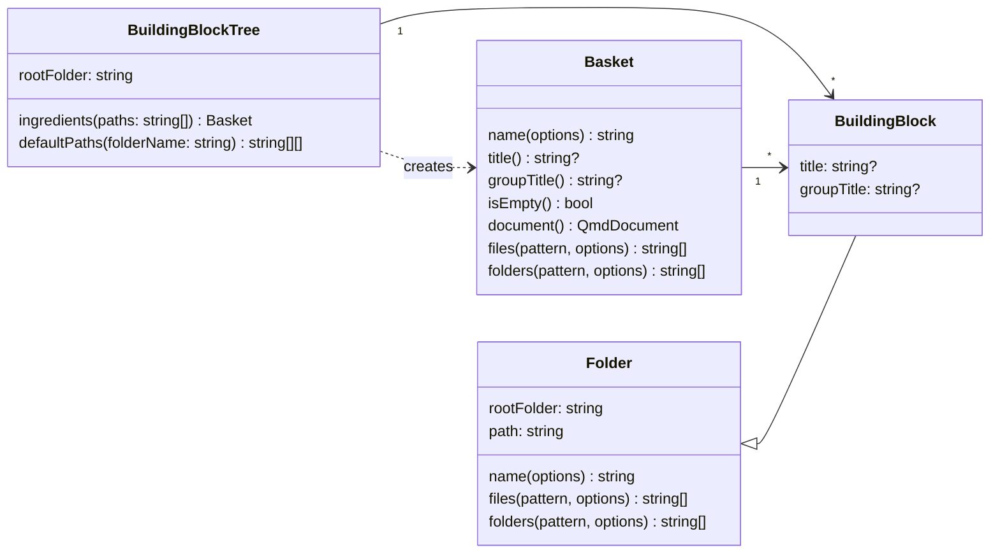
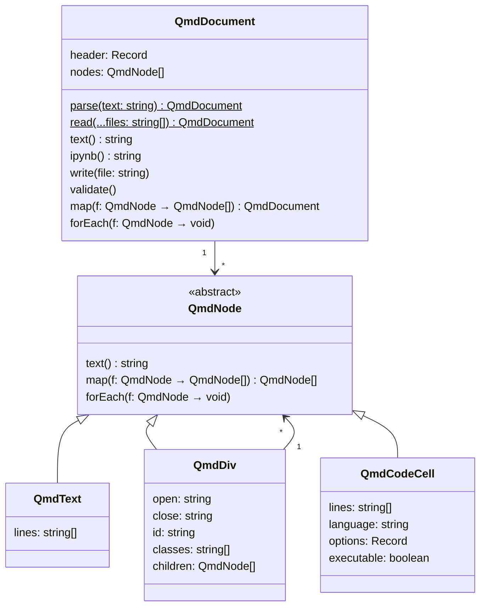
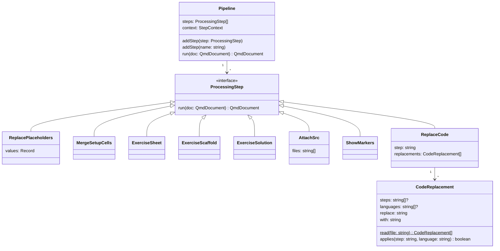
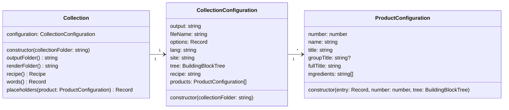
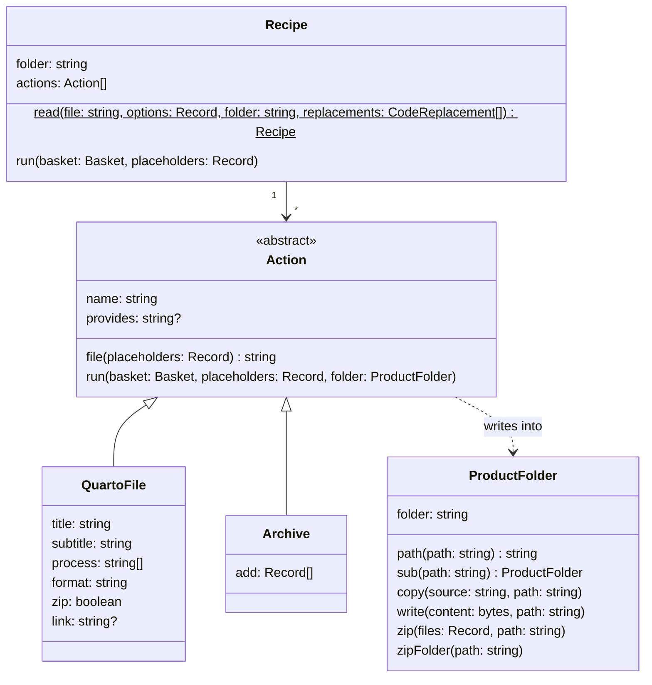
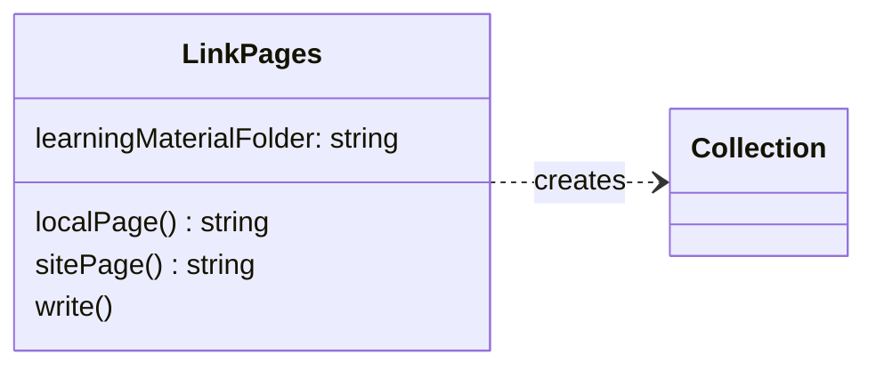

# Design

How loi-moi does what SPEC describes.

## Overview

Running `quarto render` in a collection folder triggers execution of loi-moi's `pre-render` script (named in the
collection's `_quarto.yml`, run in the collection folder) which

1. collects required information, most importantly
    1. a representation of the `building-blocks` tree
    1. the configuration from `loimoi.yml`
    1. the list of products
    1. the recipe
1. clears `c/`
1. runs the recipe's actions for each product

Remarks:

- any error stops execution

## Tools

### Model of the building block source tree

Provide simple access to ingredients.



Remarks:

- `Basket`: the ingredients for one product; `name()`, `title()`, `groupTitle()` are the defaults for the product,
  from the first building block; `document()` reads the `.qmd` files of all ingredients together and validates them once, for all actions of the product
- `rootFolder`: absolute path to building block tree; `Folder` needs it to read from disk and to return paths
  relative to it
- `name(options)`: derived from file system path, leading numbers stripped, options `full`, `sep`
- `files(pattern, options)`, `folders(pattern, options)`: paths relative to `rootFolder`, option `absolute`

### Quarto document processing

Make processing of Quarto files simple

#### Model of Quarto document



Remarks:

- `read(...files)`: headers merged, error if values clash
- `write(file)`: a Jupyter notebook for `.ipynb`, otherwise Quarto
- `map(f)`: each node replaced by `f(node)` (none, itself, or several); a `QmdDiv` maps its children first

#### Processing steps



Remarks:

- `ReplacePlaceholders` also replaces in the header
- `AttachSrc` puts the files of `src/` into an appendix of the document, as code blocks (not executed)
- `Pipeline`: steps added by their name are created with what they need from its context (`StepContext`: the files of `src/`, the heading of the appendix)
- `QuartoFile` adds a `ReplaceCode` after each step of `process`; the replacements from `code-replacements.yml`, read in `Collection.recipe()` and passed via `Recipe.read` to each `QuartoFile`

## Process

The pre-render script runs the whole process:

1. Create `Collection` from the collection folder, which makes the building block tree
1. Clear the `c/` folder
1. For each product:
    1. get its `Basket` from the building block tree
    1. compute the placeholders (`Collection.placeholders()`): words, `n`, `nn`, `nn-name`, `name`, `hash`, `product-title`, `group-title`, `full-title`, `site`, then `file-name` from these
    1. run the recipe in the folder of the product, `c/${nn-name}/`
1. Write the link pages for all collections of the learning material (`LinkPages`)

In detail.

### Configuration of one collection



`CollectionConfiguration`: the `loimoi.yml` files merged along the path, every default filled in; all checks of the settings here, so the methods of `Collection` need none. The allowed settings and their fixed defaults in `config/settings.yml` (not replaceable); the other defaults computed, some via `conventions.yml` or the Git remote.

YAML configuration (e.g. `recipes/exercises.yml`) in `_extensions/loimoi/config/`; a file with the same path in `learning-material/_loimoi/` replaces it (`configFile()` in `utilities.ts`). Exception: `conventions.yml`, the first
`_loimoi/conventions.yml` upward from the working directory (`conventions()`).

`resolve(names, folder)` in `utilities.ts`: upward from `folder`, the first folder containing one of `names` (e.g. the names of `building-blocks` listed under `names` in `conventions.yml`); error if none or several in the same folder.

### Recipe and Action classes



Remarks:

- `QuartoFile` copies the folders of the ingredients next to the written file (not into a zip; special folders
  `src/` and `zip/<name>/` → `<name>.zip`, both not into work files), without names starting with `_` or `.` and
  `…_files` (`studentFiles()` in `utilities.ts`); an `Archive` copies folders in `add` the same way
- `QuartoFile` copies the files referenced in the document (e.g. `images/a.svg` to
  `c/01-convergence-sequences/images/a.svg`)
- `ProductFolder`: all writing into the folder of the product; error if a file of the same name differs (possible
  when a product has several building blocks); `Archive` zips a folder other actions may have filled
- `Recipe.run`: creates the `ProductFolder` (`folder` plus `${nn-name}`), adds the placeholders from `provides`
  (`file()` of the action), runs the actions in order in that folder

### Link pages



Remarks:

- Collections: the folders in `learningMaterialFolder` with a `_quarto.yml`; a `Collection` for each
- Per product: the actions of the recipe with a `link` (label, with placeholders), the path from `file()` (`.qmd` becomes `.html`) in `c/${nn-name}/`
- `Collection.renderFolder()`: `output-dir` from `_quarto.yml`, absolute (`outputFolder()` is `c/`, where loi-moi writes); `links.html` links relative to it, `links-site.html` uses `site` plus the part after `__output/`

## Decisions

- **Pandoc finds the structure, loi-moi cuts the original text.** Cells stay exactly as written; `pandoc.write`
  would turn ` ```{julia} ` into a plain code block.
- **Everything before Quarto, no filter.** A filter runs per document, loi-moi needs the whole collection.
- **Names from folders, not from `about.yml`.** Renaming a folder is deliberate, retyping a title is not.
- **No project type.** A Quarto project has one type, collections need different ones (`book` for course notes);
  so `_quarto.yml` names the pre-render script, shared settings via `metadata-files`. Quarto requires an extension
  to contribute something: loi-moi contributes the metadata `loimoi: true`.
- **Code runs on copies.** The folders of the ingredients are copied into the folder of the product in `c/`, so code reading `data/…` runs there
  as in the work files; no folder name fixed, no working directory changed per language (as in the prototype).
- **Steps only change content.** How a file is written (`format`, `zip`) is a setting of `QuartoFile`, not a step.
- **Jupyter notebooks written as JSON, not with `quarto convert`.** `quarto convert` needs a Jupyter kernel for
  the language installed on the machine (Julia and R run with other engines in Quarto) and has no option to set
  it; without one, code cells end up as text.

## Development

- One file per class, named after the class (`qmd-document.ts`); free functions in `utilities.ts`
- Names for paths: `…Folder`, `…File` absolute (`outputFolder`); `path`, `…Path` relative to a base folder named in
  the class or a comment (`Folder.path`); `…Name` only the last part (`collectionFolderName`); always "folder", not "dir"
- Tests: the pre-render output of each example compared with `tests/expected/<example>/` (zips by content), the examples covering all functionality, each aspect in one example only; invalid input in `tests/invalid/`; few unit tests
- `deno task test`, `deno task check`, `deno task update-expected`, `make examples`
- Simple; comments sparingly, only where the code doesn't say it; no `continue`/`break`; no environment variables
