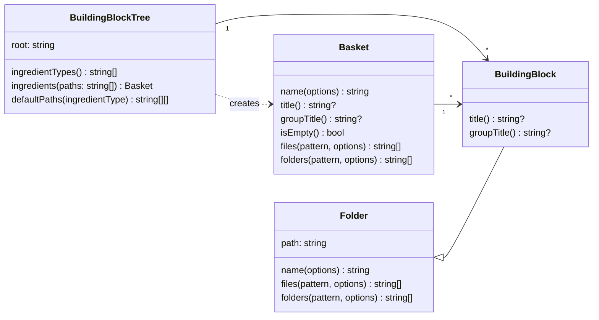
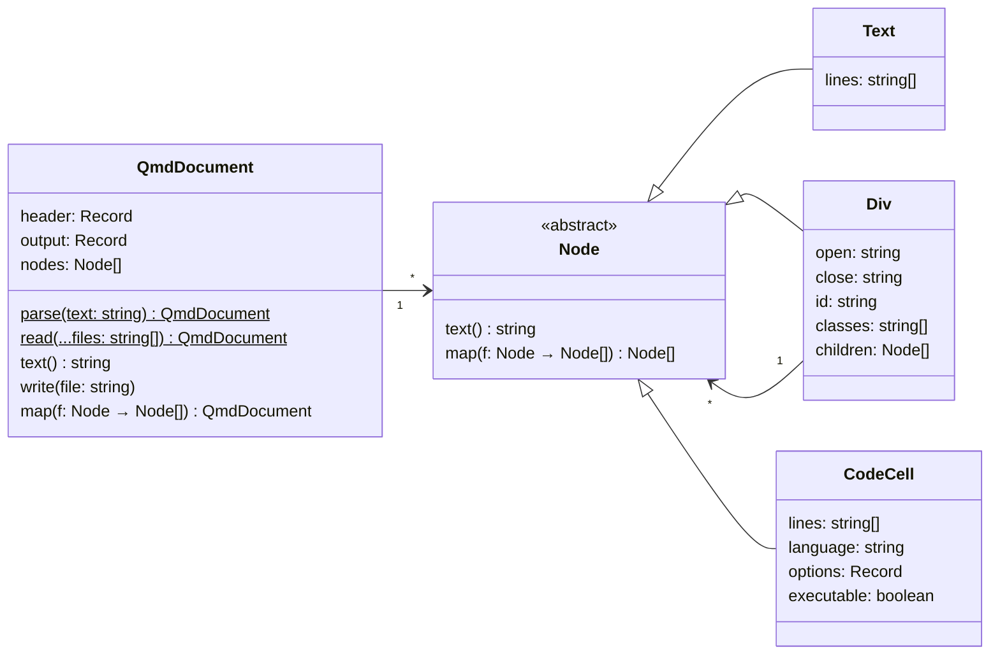
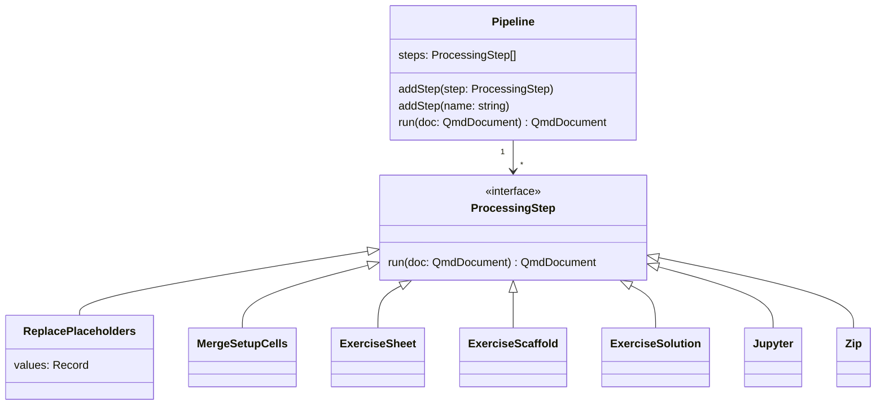

# Design

How loi-moi does what SPEC describes.

## Overview

Running `quarto render learning-material/<collection>` triggers execution of loi-moi's `pre-render` script which

1. collects required information, most importantly
    1. a representation of the `building-blocks` tree
    1. the configuration from `loimoi.yml`
    1. the list of ingredients
    1. the recipe
1. clears `c/`
1. runs the recipe's actions for each entry in the ingredients list

Remarks:

- any error stops execution

## Tools

### Model of the building block source tree

Provide simple access to ingredients.

Remarks:

- `Basket`: the ingredients of one product
- `BuildingBlock.root`: Absolute path to building block tree
- `name(options)`: derived from file system path, leading numbers stripped, options `full`, `sep`

### Quarto document processing

Make processing of Quarto files simple

#### Model of Quarto document

Remarks:

- `read(...files)`: headers merged, error if values clash
- `map(f)`: each node replaced by `f(node)` (none, itself, or several); a `Div` maps its children first

#### Processing steps

Remarks:

- `ReplacePlaceholders` also replaces in the header
- `output`: `format` (`qmd` or `ipynb`, default `qmd`) and `zip` (default `false`), set by `Jupyter` and `Zip`

## Process

The pre-render script runs the whole process:

1. Configuration

  1. Figure out defaults for entries missing in `loimoi.yml`

  1. Per product: values for the placeholders (naming), filled into the settings

1. List of ingredients

  1. Collect the ingredients of each product

1. Recipes

  1. A recipe is a set of actions required to transform ingredients into a product

1. Actions

  1. Quarto file: Collect Quarto file from ingredients, process and save it.

  1. Archive: Copy files into a folder and create an archive

## Decisions

## Development
