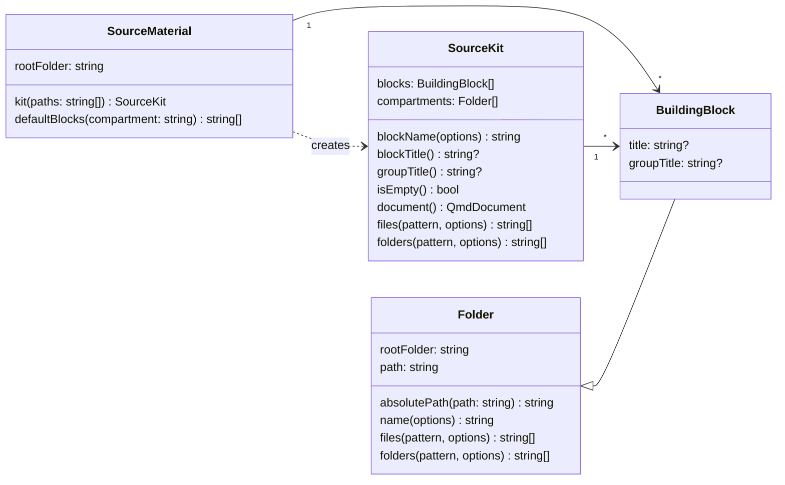
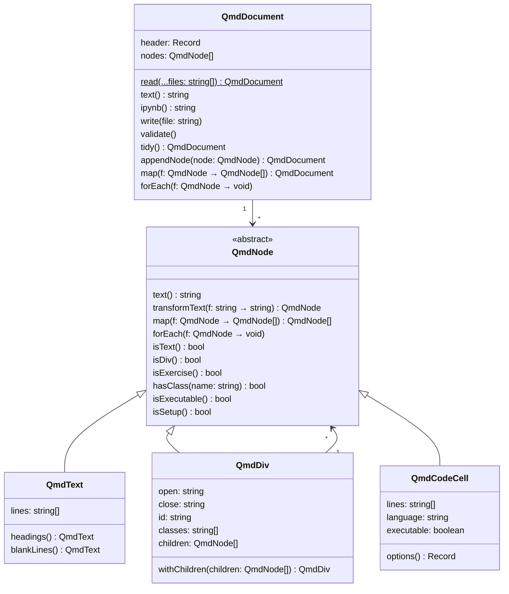
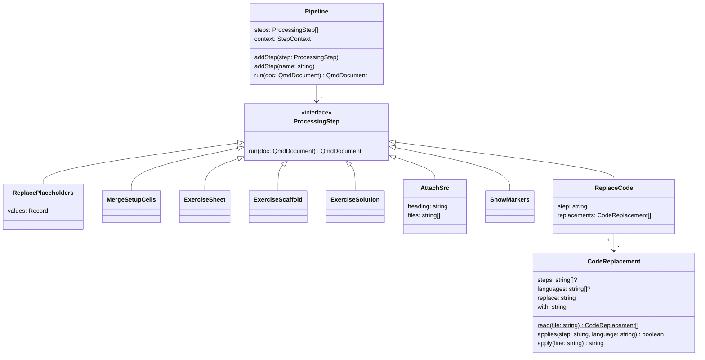
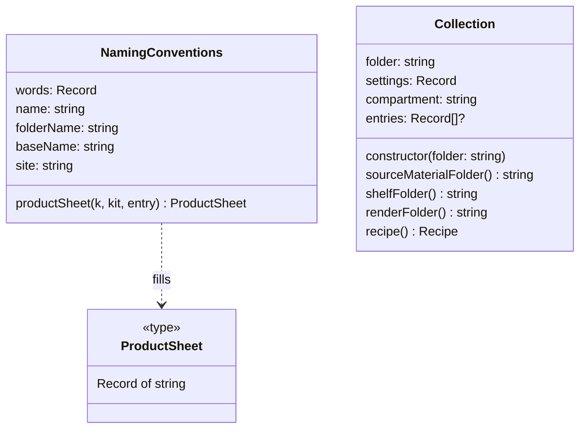
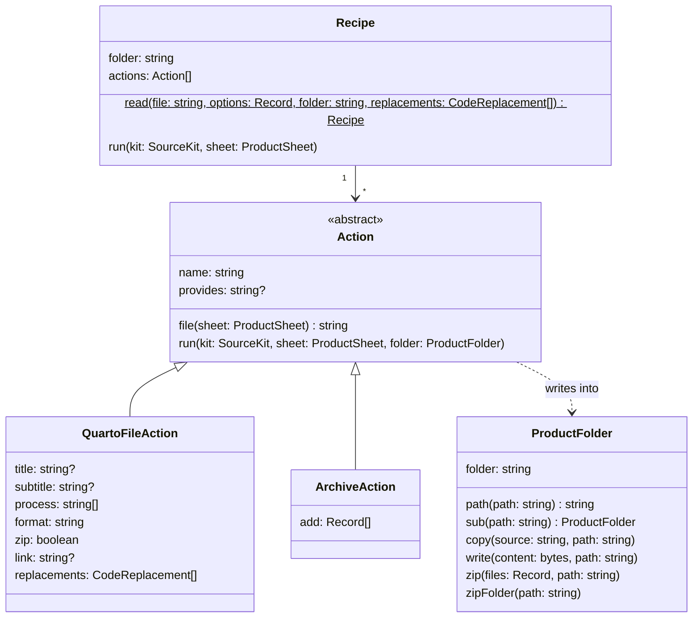
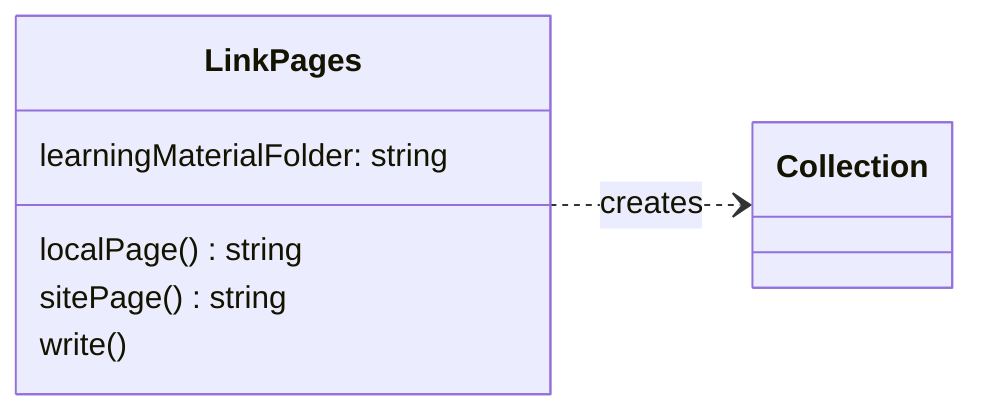

# Design

How loi-moi does what SPEC describes.

## Overview

The `pre-render` script runs in a collection folder inside `learning-material` and puts the products on the shelf for Quarto. The script

1. gets the recipe from the collection
1. collects a kit for each product of the collection
1. for each kit, gets the product sheet from the naming conventions and passes both to the recipe

In order to simplify things, some tools are employed:

- a source material object provides the kits
- a naming conventions object knows how things are named (name patterns, words in the collection's language), fills the product sheet

Remarks:

- any error stops execution

## Tools

### Model of the source material

The source material object provides the source kits.



Remarks:

- `SourceKit`: the compartments for one product; `blockName()`, `blockTitle()`, `groupTitle()` are those of the first building block, the collection uses them as defaults for the product sheet; `document()` reads the `.qmd` files of all compartments together and validates them once, for all actions of the product
- `rootFolder`: absolute path to the source material folder; `Folder` needs it to read from disk and to return paths relative to it
- `name(options)`: derived from file system path, leading numbers stripped, options `full`, `sep`
- `files(pattern, options)`, `folders(pattern, options)`: paths relative to `rootFolder`, option `absolute`

### Quarto document processing

Makes processing Quarto files simple.

#### Model of Quarto document



Remarks:

- `read(...files)`: headers merged, error if values clash
- `write(file)`: a Jupyter notebook for `.ipynb`, otherwise Quarto
- `map(f)`: each node replaced by `f(node)` (none, itself, or several); a `QmdDiv` maps its children first
- `transformText(f)`: a new node with `f` applied to each line of text; a `QmdDiv` only to its children (its opening line holds fixed things); a `QmdCodeCell` unchanged, as its code may use `${…}` itself (shell, JavaScript)
- `options()`: read from the `#|` lines when asked, so they always match the lines
- `isText()` … `isSetup()`: type checks (`this is QmdText`, …), `false` in `QmdNode`, overridden where true; after a check TypeScript knows the subclass, so no `instanceof Qmd…` outside `qmd-node.ts`; an exercise is a div with an id `exr-…`, a setup cell has the label `setup`
- `tidy()`: removing parts leaves blank lines behind: neighbouring texts joined, runs of blank lines reduced to one, none at the start, none before the end of a div
- `headings()`: text in an exercise reduced to its headings, blank lines kept

#### Processing steps



Remarks:

- `ReplacePlaceholders`: fills in the values of the product sheet (`values`), also in the header
- `AttachSrc` puts the files of `src/` into an appendix of the document, as code blocks (not executed)
- `Pipeline`: steps added by their name are created with what they need from its context (`StepContext`: the files of `src/`, the heading of the appendix)
- `QuartoFileAction` adds a `ReplaceCode` after each step of `process`; the replacements from `code-replacements.yml`, read in `Collection.recipe()` and passed via `Recipe.read` to each `QuartoFileAction`

## Process

The `pre-render` script, as in the Overview:

1. `collection = new Collection(folder)`: reads and checks the settings
1. `recipe = collection.recipe()`
1. clear the shelf (`collection.shelfFolder()`)
1. for each kit and product sheet of `products(collection)`: `recipe.run(kit, sheet)`, in the folder of the product on the shelf
1. write the link pages for all collections of the learning material (`LinkPages`), which use `products(collection)` too

`products(collection)`, in `utilities.ts`, returns a kit and a product sheet for each entry. It makes the source material and the naming conventions; the entries are `collection.entries`, or, without `products`, one per block of `sourceMaterial.defaultBlocks(collection.compartment)`. Error messages name the collection, as the link pages call it for all collections.

### Collection and naming conventions



Remarks:

- `Collection`: what the teacher configured, nothing else: the collection folder with its settings, every value final: `_collection.yml` over `learning-material/_loimoi.yml`, then the defaults (`config/settings.yml`; `conventions.yml` by collection folder name; the resolved Quarto configuration for `lang` and `output-dir`; the Git remote for `site`). All checks are here; an unknown setting is an error.
- `entries`: the entries of `products` as plain data (blocks, optional `name`, `product-title`, `group-title`); missing without `products`.
- `NamingConventions`: the words in the collection's language and the name patterns. `productSheet` fills in this order: `n`, `nn`, words, `block-path`, `block-folder`, `product-title` and `group-title` (from the entry, otherwise from the kit), `full-title`, `title-slug`, `name`, `hash` (from `nn` and `name`), `folder-name`, `base-name`, `site`.
- `ProductSheet`: a `Record`; the recipe passes it to `ReplacePlaceholders`.

Configuration files: built in, in `_extensions/loimoi/config/`; own ones in the first `_loimoi/` upward from the collection folder replace them.

### Recipe and Action classes



Remarks:

- `QuartoFileAction` copies the folders of the compartments next to the written file (not into a zip; special folders `src/` and `zip/<name>/` → `<name>.zip`, both not into work files), without names starting with `_` or `.` and `…_files` (`studentFiles()` in `utilities.ts`); an `ArchiveAction` copies folders in `add` the same way
- `QuartoFileAction` copies the files referenced in the document (e.g. `images/a.svg` to `c/01-convergence-sequences/images/a.svg`)
- `ProductFolder`: all writing into the folder of the product; error if a file of the same name differs (possible when a product has several building blocks); `ArchiveAction` zips a folder other actions may have filled
- `Recipe.run`: creates the `ProductFolder` (`folder` plus `${folder-name}`), adds the values from `provides` to the product sheet (`file()` of the action), runs the actions in order in that folder

### Link pages



Remarks:

- Collections: the folders in `learningMaterialFolder` with a `_collection.yml`; a `Collection` for each, its products from `products(collection)`
- Per product: the actions of the recipe with a `link` (label, filled from the product sheet), the path from `file()` (`.qmd` becomes `.html`) in `c/${folder-name}/`
- `Collection.renderFolder()`: `output-dir` from the resolved Quarto configuration, absolute (`shelfFolder()` is `c/`, where loi-moi writes); `links.html` links relative to it, `links-site.html` uses `site` plus the part after `__output/`

## Decisions

- **Pandoc finds the structure, loi-moi cuts the original text.** Cells stay exactly as written; `pandoc.write` would turn ` ```{julia} ` into a plain code block.
- **Everything before Quarto, no filter.** A filter runs per document, loi-moi needs the whole collection.
- **Names from folders, not from `_about.yml`.** Renaming a folder is deliberate, retyping a title is not.
- **No project type.** A Quarto project has one type, collections need different ones (`book` for course notes); so `_quarto.yml` names the pre-render script, shared settings via `metadata-files`. Quarto requires an extension to contribute something: loi-moi contributes the metadata `loimoi: true`.
- **Code runs on copies.** The folders of the compartments are copied into the folder of the product on the shelf, so code reading `data/…` runs there as in the work files; no folder name fixed, no working directory changed per language (as in the prototype).
- **Steps only change content.** How a file is written (`format`, `zip`) is a setting of `QuartoFileAction`, not a step.
- **Jupyter notebooks written as JSON, not with `quarto convert`.** `quarto convert` needs a Jupyter kernel for the language installed on the machine (Julia and R run with other engines in Quarto) and has no option to set it; without one, code cells end up as text.

## Development

- One file per class, named after the class (`qmd-document.ts`); free functions in `utilities.ts`
- Names for paths: `…Folder`, `…File` absolute (`shelfFolder`); `path`, `…Path` relative to a base folder named in the class or a comment (`Folder.path`); `…Name` only the last part (`collectionFolderName`); always "folder", not "dir"
- Tests: the pre-render output of each example compared with `tests/expected/<example>/` (zips by content), the examples covering all functionality, each aspect in one example only; invalid input in `tests/invalid/`; few unit tests
- `deno task test`, `deno task check`, `deno task update-expected`, `make examples`
- Simple; comments sparingly, only where the code doesn't say it; no `continue`/`break`; no environment variables
