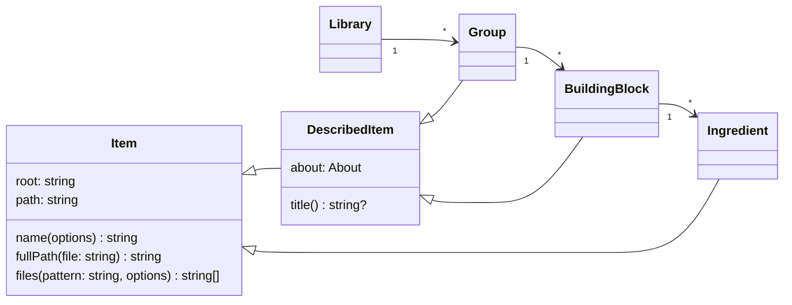
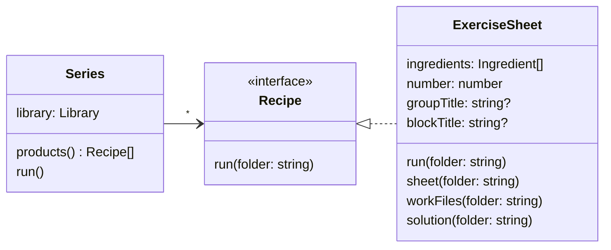
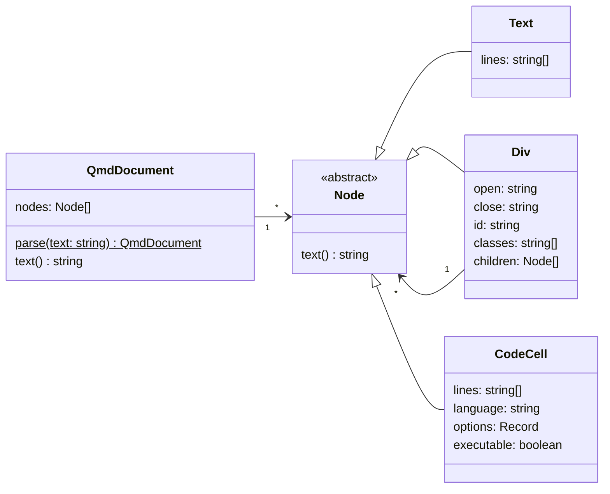

# Design

How loi-moi does what SPEC describes.

## Quarto integration

1. The project has the type `loimoi`. Before Quarto renders, the extension generates the content of `c/`.
2. `bausteine/` has its own `_quarto.yml` with the marker filter, so files there render on their own. The filter
   only marks solution (green) and scaffold (blue); it decides nothing.
3. **Open:** how the teacher views a file as one part of its product; it goes through loi-moi, not the filter.

## Processing

1. A data structure represents the library (see below).
2. A series (or, later, a standalone product) produces the content of `c/` from it, with one recipe per product
   (see below).
3. For now, all strings and rules are in code; settings (defaults, `loimoi.yml`) are factored out once it works.
4. loi-moi does all processing before Quarto: it writes the finished `.qmd` of each part into `c/` (e.g. the
   exercise sheet without solution code), and Quarto only renders. Reasons: control (Quarto does not run code that
   is removed anyway) and all rules in one place.
5. loi-moi is written in TypeScript (Deno, comes with Quarto); the marker filter in Lua.

### Data structure



1. `root`: the folder `bausteine/`; `path`: relative to it, e.g. `01-bohrpfahl/01-grundlagen/aufgaben`.
2. `name()`: the folder name without leading number, e.g. `grundlagen`; `name({ full: true })`: the path without
   numbers, e.g. `bohrpfahl/grundlagen`; with `separator: "-"` for file names.
3. `fullPath(file)`: the full path of a file in the item's folder; without `file` the folder itself.
4. `about`: `about.yml` as read, unchecked; `title()` is undefined without a `title`.
5. `files(pattern)`: the files matching a glob pattern, relative to the item and sorted by name, e.g.
   `*.qmd`, `src/*.py`; with `{ full: true }` full paths.
6. References only go downwards.

### Recipes



1. A recipe makes one product; it only sees its ingredients and the values handed to it.
2. `Series` selects the building blocks and creates one recipe per product with its ingredients, number and
   titles; `run(folder)` writes the product into the output folder. For now: one exercise sheet per building
   block with `aufgaben`, in library order (numPDE, numMat). Later, for Mathe B, `loimoi.yml` decides the
   selection and the recipe class.
3. `ExerciseSheet.run(folder)`: combine the `.qmd` files of the ingredients; split the text into text, `setup`
   cells and exercises with their parts; then `sheet()`, `workFiles()` and `solution()` write the three parts into
   `folder` (SPEC, "Processing").
4. `workFiles()` writes the notebook (`.ipynb` as JSON) or the `.qmd` directly, without Quarto, and zips it with
   the files from the ingredient using a JavaScript library.

5. Splitting: `quarto pandoc -f commonmark_x+sourcepos -t json` gives every div and code block with its line
   range (`data-pos`), including nesting and the language of cells. loi-moi cuts the original text at these lines,
   so cells stay as written (no `pandoc.write`). Divs without id and class are Pandoc's position wrappers and are
   skipped.

### Document model



1. `QmdDocument` (`qmd-document.ts`) knows only Quarto Markdown, nothing about exercises; reusable for slides
   and course notes.
2. Every node keeps its original lines (`Div`: the fence lines `open` and `close`, the rest in its children);
   `text()` puts them together, so the document is written exactly as read.
3. `Text`: the lines between divs and code cells. `CodeCell`: `executable` for ` ```{r} `, not for ` ```{.r} `;
   `options` from the `#|` lines.
4. The exercise model is built on top in the recipe: an exercise is a `Div` with an `#exr-…` id, a solution a `Div`
   with `.lm-solution`, etc. There, `isProgramming()` and filling in a missing scaffold are defined.

## Development

1. Deno installed separately (Homebrew) for development (`deno test`, `deno check`, VS Code Deno extension); at
   run time Quarto uses its own Deno.
2. Tests on two levels: unit tests with `deno test` (fast, without Quarto) and the examples as end-to-end tests
   (`quarto render`, then check `c/`; before a commit).
3. Structure:

   ```
   _extensions/loimoi/         shipped with the extension
     _extension.yml
     pre-render.ts             entry point, called by Quarto
     library.ts                data structure
     qmd-document.ts           document model
     utilities.ts              helpers for folders and files
     series.ts                 series: reads loimoi.yml, creates the recipes
     recipes/
       exercise-sheet.ts
     markers.lua, markers.css  marking when writing
   tests/                      not shipped; unit tests use the examples as input
   examples/
   ```

4. `deno.json` in the project root with tasks (`test`, `check`) and imports. To check: Quarto's Deno may pick it
   up when an example runs the extension.
5. Each step: explain what is implemented → approval → code and unit test → review (with a short explanation of
   new TypeScript constructs) → commit after approval.
