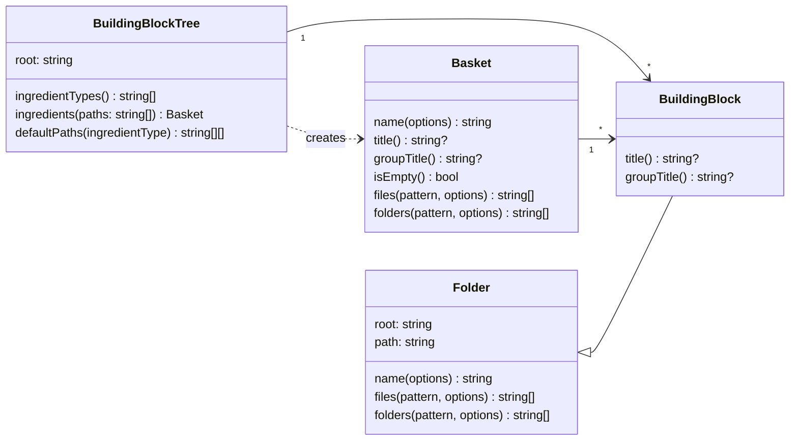
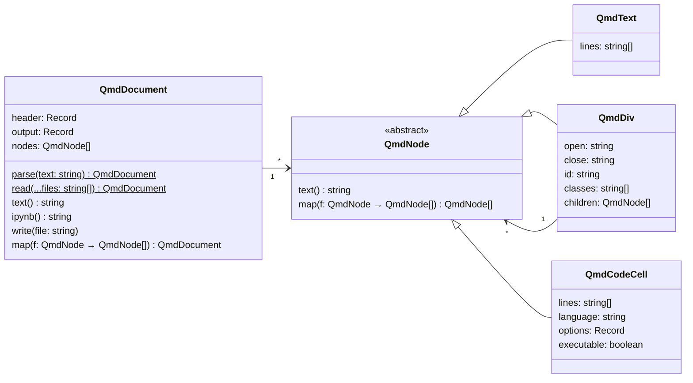
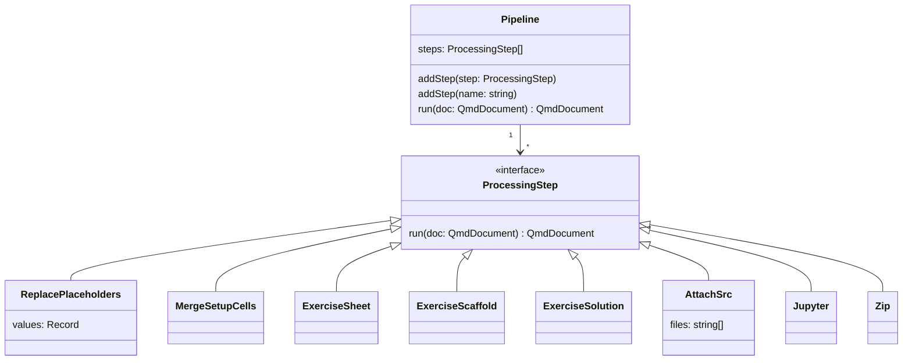
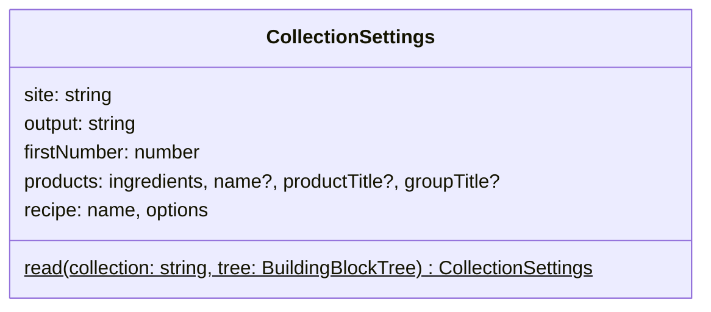
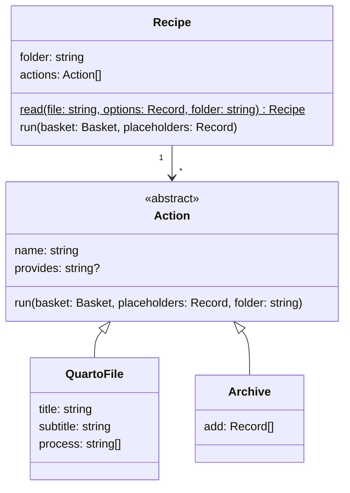

# Design

How loi-moi does what SPEC describes.

## Overview

Running `quarto render learning-material/<collection>` triggers execution of loi-moi's `pre-render` script which

1. collects required information, most importantly
    1. a representation of the `building-blocks` tree
    1. the configuration from `loimoi.yml`
    1. the list of products
    1. the recipe
1. clears `c/`
1. runs the recipe's actions for each product

Remarks:

- any error stops execution

## Tools

### Model of the building block source tree

Provide simple access to ingredients.



Remarks:

- `Basket`: the ingredients for one product; `name()`, `title()`, `groupTitle()` are the defaults for the product,
  from the first building block
- `root`: absolute path to building block tree; `Folder` needs it to read from disk and to return paths
  relative to it
- `name(options)`: derived from file system path, leading numbers stripped, options `full`, `sep`
- `files(pattern, options)`, `folders(pattern, options)`: paths relative to `root`, option `absolute`

### Quarto document processing

Make processing of Quarto files simple

#### Model of Quarto document



Remarks:

- `read(...files)`: headers merged, error if values clash
- `output`: `format` (`qmd` or `ipynb`, default `qmd`) and `zip` (default `false`)
- `map(f)`: each node replaced by `f(node)` (none, itself, or several); a `QmdDiv` maps its children first

#### Processing steps



Remarks:

- `ReplacePlaceholders` also replaces in the header
- `AttachSrc` puts the files of `src/` into an appendix of the document, as code cells; `files` from
  `basket.files("src/*")`

## Process

The pre-render script runs the whole process:

1. Create `CollectionSettings` object from `loimoi.yml` and building block tree
1. Collect list of `Basket` objects from building block source tree
1. Create `Recipe` object
1. Clear `c/` folder
1. Run actions in recipe for each basket

In detail.

### Settings for one collection



The `read` method 
  1. sets fixed defaults (`output`, `firstNumber`)
  1. merges `loimoi.yml` files along the path over them
  1. derives what's missing from defaults

### Recipe and Action classes



Remarks:

- `QuartoFile` copies the files referenced in the document (e.g. `images/a.svg` to `c/images/a.svg`); error if a
  file of the same name differs
- `Recipe.run`: adds the placeholders from `provides` (filled-in `name` of the action), runs the actions in order

## Decisions

- **Pandoc finds the structure, loi-moi cuts the original text.** Cells stay exactly as written; `pandoc.write`
  would turn ` ```{julia} ` into a plain code block.
- **Everything before Quarto, no filter.** A filter runs per document, loi-moi needs the whole collection.
- **Names from folders, not from `about.yml`.** Renaming a folder is deliberate, retyping a title is not.
- **Jupyter notebooks written as JSON, not with `quarto convert`.** `quarto convert` needs a Jupyter kernel for
  the language installed on the machine (Julia and R run with other engines in Quarto) and has no option to set
  it; without one, code cells end up as text.

## Development

- One file per class, named after the class (`qmd-document.ts`); free functions in `utilities.ts`
- Tests: assertion first; unit tests for `BuildingBlockTree`, `QmdDocument` and the steps; each example one test,
  each aspect in one example only
- `deno task test`, `deno task check`, `make examples`
- Simple and commented; no `continue`/`break`; no environment variables
