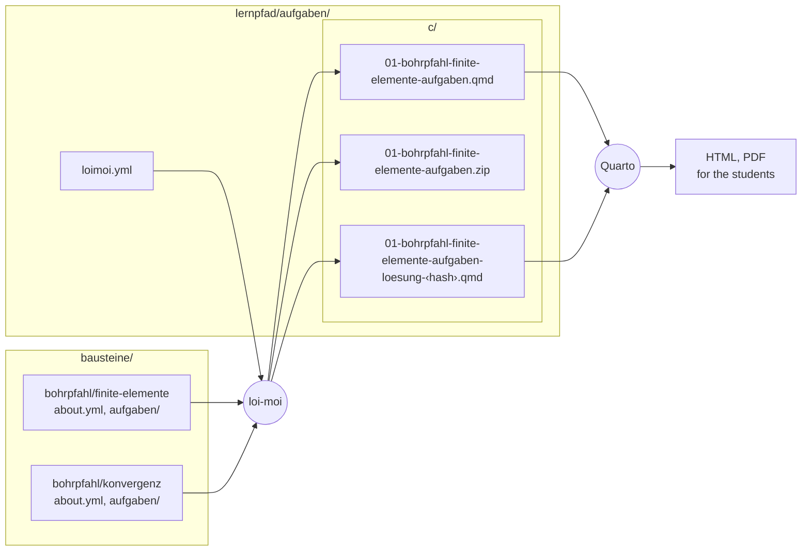

# Specification

What loi-moi does, without deciding how.



## Terms

- **Library:** all material maintained by the teacher.
- **Group:** related building blocks.
- **Building block:** material on one topic, independent of where it is used.
- **Ingredient:** the part of a building block for one kind of product, e.g. its exercises or its slides.
- **Learning path:** all products of a course.
- **Product:** a set of related files, e.g. exercise sheet, work files and solution. Everything that depends on
  where it is used (number, title, file names) belongs to the product.
- **Work files:** what the students download to work with a product, e.g. a notebook with scaffolds for exercises,
  or the project for R slides.
- **Series:** products of the same kind in a fixed order, numbered. A product is either part of a series or
  stands alone (e.g. course notes).
- **Exercise:** a single task with a title (e.g. "Bohrpfahl"), with everything that belongs to it: text,
  solution, scaffold, given code, setup. A task with parts (a, b, …) is one exercise.
- **Exercise sheet:** several exercises, plus text that structures them (e.g. headings of parts, download text).
  With work files and solution, it forms a product.

## Scope

The first version produces one series: the exercise sheets. Later, further series (slides) and standalone
products (course notes, all slides in one document, course slides) are to follow (see ANALYSIS).

## Groups and building blocks

The folder `bausteine/` holds the library. Three examples:

**Flat** (as in Informatik): all building blocks directly in `bausteine/`.

```
bausteine/
  _templates/          ignored
  01-einfuehrung/
    about.yml
    folien/
    aufgaben/
  02-installation/
  03-elementare-datentypen/
```

**Grouped by part** (does not exist yet): one folder per part of a course, in a fixed order. The same name can
occur in several parts.

```
bausteine/
  01-bohrpfahl/
    about.yml          title: Bohrpfahl
    01-grundlagen/
      about.yml        title: Grundlagen
      folien/
      aufgaben/
    02-variationsprobleme/
  02-waermeleitung/
    about.yml
    01-grundlagen/
    02-dirichlet-randbedingungen/
```

**Grouped by subject** (as in Mathematik B): one folder per subject. The groups are different aspects of the same
topics; products can take material from several groups (e.g. an exercise sheet with statistics and R exercises).

```
bausteine/
  statistik/
    statistische-daten/
      folien/
      aufgaben/
      skript/
    einzelne-merkmale/
  r/
    erste-schritte/
    einzelne-merkmale/
```

Each group is a folder with building blocks, an optional `about.yml` and optional files. Groups are not nested.

- **`about.yml`** (optional): a `title`, e.g. for groups by topic.
- **Files** (optional): files its building blocks use, e.g. a bibliography.

Each building block is a folder with subfolders for material and an optional `about.yml`:

- **Subfolders** hold the material for one kind of product each: `folien/` for slides, `aufgaben/` for exercise
  sheets, `skript/` for course notes. The `.qmd` files directly in a subfolder are combined into one before any
  further processing, in the order of their names; subfolders (e.g. `src/`, images) are not combined.
- **`about.yml`** (optional) describes the building block, with English keys. Currently only `title` is used, by
  products for titles. Additional information (e.g. a list of topics) can deliberately be added. Without
  `about.yml`, the title of the product comes from the learning path (`loimoi.yml`).

Rules for the folder `bausteine/`:

- A building block is a folder with at least one material subfolder (`folien/`, `aufgaben/`, `skript/`).
- `bausteine/` contains either building blocks (then it is the group) or groups, not both.
- Folder names can start with a number (`01-`). It only sorts and is not part of the name.
- The name of a building block is its path below `bausteine/` without numbers, i.e. including its group, e.g.
  `bohrpfahl/grundlagen`. Names must be unique.
- Folders starting with `_` are ignored (e.g. `_templates/`).
## Learning path

The folder `lernpfad/` describes the learning path: one folder per series or standalone product.

- By convention, the name of the folder sets the kind of product and the material it takes from the building
  blocks (the subfolder with the same name):
  - `aufgaben/`: a series of exercise sheets
  - `folien/`: a series of slide sets
  - `skript/`: one book from all `skript/` folders
  - `folien-alle/`: one book from all `folien/` folders

  The building blocks are taken in the order of the folders, groups first.
- Each folder can have a `loimoi.yml` that overrides the convention; without it, the folder works by convention.
  `loimoi.yml` can set:
  - the kind of product
  - how the `.qmd` files of the building blocks are combined: which building blocks and files (by default all
    `.qmd` files directly in the material subfolder), their order, additional content (e.g. headings of parts,
    download text)
  - title and key per product
  - the patterns for file names
  - the URL of the published site; by default derived from the Git remote (`https://<user>.github.io/<repo>`)
  - the output folder (e.g. `d/` to compare with today's scripts)
- `lernpfad/` itself can have a `loimoi.yml`; the folders inherit its content (and can override it), e.g. the
  URL.
- A folder can hold settings for its products (e.g. format, logo, literature in `_metadata.yml`) and extra files
  (e.g. front page and bibliography of a book).
- The generated files go into an output folder, by default `c/`, not under version control.

**By convention** (as in numPDE, numMat, Informatik):

```
lernpfad/
  aufgaben/
    loimoi.yml         format of the work files
    c/                 generated
  folien/
    c/
  skript/
    c/
  folien-alle/
    c/
```

**With configuration** (as in Mathematik B):

```
lernpfad/
  loimoi.yml           for all folders, e.g. the URL
  aufgaben/
    loimoi.yml         exercise sheets from statistics and R building blocks
    c/                 generated
  statistik-folien/
    loimoi.yml         slides from the group statistik
  r-folien/
    loimoi.yml         slides from the group r
  r-folien-alle/
    loimoi.yml         book from the slides of the group r
  skript/
    loimoi.yml         book from the group statistik, in this order
```

**Side note:** the folder names (`bausteine/`, `lernpfad/`, `aufgaben/`, `folien/`, `skript/`, `folien-alle/`) are
German; they can be internationalized (e.g. English names).

**Todo:** content that belongs to no building block (course slides, folder structure to download): where it lives.

## Products

loi-moi generates the content of `c/`; Quarto renders it into what the students get (directed by `_quarto.yml`
and `_metadata.yml`).

The file names of products in a series are built from:

- `<slug>`: number of the product in the series (two digits), then the name of its first building block with `/`
  as `-`; e.g. `02-bohrpfahl-variationsprobleme`.
- `<hash>`: the first 8 hex digits of `sha1("87362-" + slug)`, for names that cannot be guessed (e.g. solutions).

Placeholders in the `.qmd` files of the building blocks are replaced:

- `${slug}`: the slug of the product, e.g. for the name of a downloaded file.
- `${site}`: the URL of the published site (see `loimoi.yml`), e.g. for absolute links.

### Exercise sheets

#### Content of `c/`

Per product (default names as in numPDE and numMat, configurable in `loimoi.yml`):

- **Exercise sheet:** a Quarto document, `<slug>-aufgaben.qmd`.
- **Work files** (if there is a programming exercise): a zip file, `<slug>-aufgaben.zip`.
- **Solution** (if there is an `.lm-solution`): a Quarto document or a zip file,
  `<slug>-aufgaben-loesung-<hash>.{qmd,zip}`.

#### In the building blocks (`aufgaben/`)

`aufgaben/` contains:

- **`.qmd` files:** text that structures the exercise sheet (e.g. headings of parts), exercises in divs
  (`#exr-…`), scaffold and solutions.
- **Subfolders** (optional): data, images or source code.

Placeholder in addition to the general ones: `${work-files}`, the absolute URL of the work files.

A programming exercise has `.lm-scaffold` or code in `.lm-solution`; other exercises are paper exercises. Only
one building block of an exercise sheet may have programming exercises.

**Paper exercise:**

````markdown
## Teil 1: Auf dem Papier

```{r}
#| label: setup
#| include: false
library(tidyverse)
```

::: {#exr-lagemasse}
## Lagemaße

Bestimmen Sie Median und Mittelwert der Werte in der folgenden Tabelle.

::: {.lm-sheet}
```{r}
#| echo: false
knitr::kable(tibble(Wert = c(3, 5, 5, 8, 14)))
```
:::

::: {.lm-solution}
Median: 5, Mittelwert: $35/5 = 7$.
:::
:::
````

**Programming exercise (R):**

````markdown
## Teil 2: Mit dem Computer

Laden Sie das [Arbeitsmaterial](${work-files}) herunter.

```{r}
#| label: setup
#| include: false
library(tidyverse)
befragung <- read_csv("daten/befragung.csv")
```

::: {#exr-entfernungen}
## Entfernungen

Berechnen Sie den Mittelwert der Entfernungen.

::: {.lm-scaffold}
```{r}
# mittelwert <- ...
```
:::

::: {.lm-solution}
Der Mittelwert beträgt …

```{r}
mittelwert <- mean(befragung$entfernung)
```
:::
:::
````

#### In the learning path (`lernpfad/aufgaben/`)

`loimoi.yml` specifies:

- the format of the work files (required): notebook (`.ipynb`) or `.qmd`
- the files and folders of `aufgaben/` that go into the work files (e.g. `daten/`, a workspace)

#### Processing

Before further processing:

1. The `.qmd` files are combined.
2. The `setup` cells are merged into one at the beginning; repeated lines are dropped.
3. Subtitle: the titles of the group and of the first building block, joined with ": " (e.g. "Bohrpfahl:
   Grundlagen").
4. Images and other linked files are copied to `c/`.

##### Exercise sheet

1. Title: "Aufgabenblatt N".
2. Removed: `.lm-solution`, `.lm-scaffold` and unwrapped code, except the `setup` cell.

##### Work files

1. Title: "Aufgabenblatt N".
2. Paper exercises are dropped.
3. Kept: the `setup` cell, exercise titles, unwrapped code and `.lm-scaffold`.
4. A solution with code but no scaffold gets an empty code cell.
5. Zipped: the document and the files and folders from `loimoi.yml`.

##### Solution

1. Title: "Lösungen zu Aufgabenblatt N".
2. Kept: the `setup` cell, exercise titles, unwrapped code and `.lm-solution`.
3. Appendix "Code": all files from `src/` of the building block.

## Usage

Writing material in a building block:

- The code runs in the editor, in the folder of the file.
- Rendering a file on its own shows everything, with markers visible (e.g. solution and scaffold).
- The teacher can view a file as each part of its product (e.g. exercise sheet, work files, solution).

Generating:

- `quarto render` in the project generates all products into `c/`; files generated before are removed.
- `quarto render lernpfad/<folder>` generates only the products of that folder (e.g. all exercise sheets).
- Errors stop with a message naming the file.
