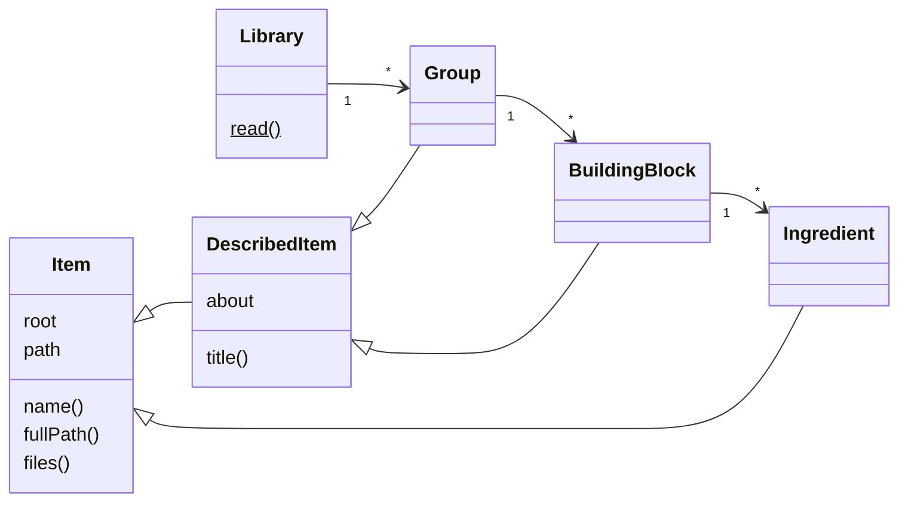
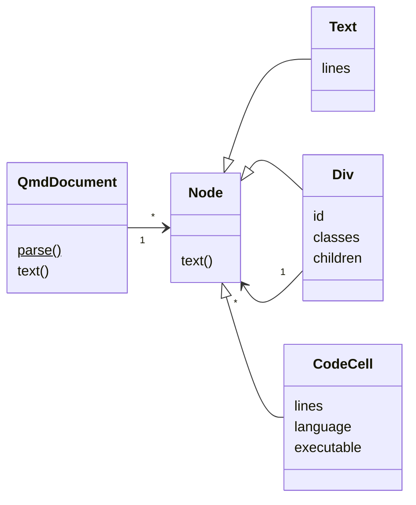
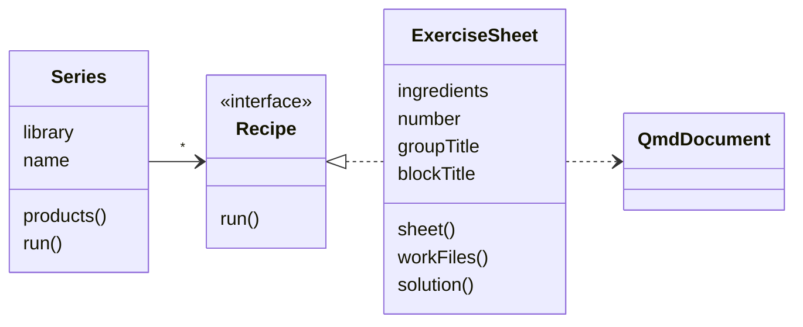

# Design

How loi-moi does what SPEC describes: the parts and one `quarto render`, then the decisions behind it with their
reasons, then how we develop. What is not done yet is in `TODO.md`.

## How it works

### The parts

- **`pre-render.ts`:** the entry point, run by Quarto before rendering. Reads configuration and library, runs the
  series.
- **`Configuration`:** the settings of a folder in `lernpfad/`: the defaults, overridden by the `loimoi.yml` files
  on the path (not implemented yet).
- **`Library`:** `bausteine/` as groups → building blocks → ingredients. Names come from the folders, `about.yml`
  is passed through as read.
- **`Series`:** owns a folder in `lernpfad/` (e.g. `aufgaben/`), selects and numbers the building blocks, creates one
  recipe per product, removes what it generated last time.
- **`ExerciseSheet`** (a `Recipe`): one exercise sheet. Combines the `.qmd` files of its ingredients, replaces the
  placeholders, parses, merges the `setup` cells; writes sheet, work files and solution.
- **`QmdDocument`:** a `.qmd` as a list of text, divs and code cells, each with its original lines. The recipe
  filters these nodes for each part.







### One `quarto render`

1. Quarto runs `pre-render.ts` in the project folder.
2. `Configuration.read("lernpfad/<folder>")` (for now the values are in `pre-render.ts`).
3. `Library.read("bausteine", ingredients)`.
4. For each series (for now only `aufgaben`): `Series.run()` removes what it generated last time
   (`.loimoi-generated`), selects the building blocks, numbers them and creates one recipe per product.
5. Each recipe (`ExerciseSheet.run()`): combine, placeholders, `QmdDocument.parse`, merge `setup`; write sheet, work
   files and solution into `c/`, return the file names.
6. Quarto renders `lernpfad/**/*.qmd`; zip files and images are already in place.

## Decisions

### Quarto integration

1. **Own extension, not part of tinh.** tinh is a collection of formats and knows nothing about exercises; loi-moi
   uses tinh. Long term, `solution-scaffold.lua` disappears from tinh.
2. **Project extension with a `pre-render` script, not a filter.** A filter runs per document and on every
   preview; the orchestration (files, names, zip files) needs to run once per project.
3. **All processing before Quarto.** loi-moi writes the finished `.qmd` of each part; Quarto only renders. Filters
   (also `pre-ast`) run after the code was executed, so a filter cannot stop Quarto from running the solution
   code on the sheet, and duplicate `setup` labels would already be an error. One place for all rules.
4. **TypeScript (Quarto's Deno) plus a Lua filter that only marks.** The filter colours solution and scaffold when
   an exercise is rendered on its own in `bausteine/`; it decides nothing. Imports with full names
   (`jsr:@std/path@1`): Quarto's Deno does not see our `deno.json`. The first run needs a network.
5. **`bausteine/_quarto.yml` is a project of its own.** A file that is not in `project: render:` is treated as
   outside the project when rendered on its own (no `lang`, no filter), and `render:` must exclude `bausteine/`
   so that `quarto render` does not render every exercise.
6. **No environment variables.** Everything comes from the configuration (for now from code).

### Library

1. **One class per thing in SPEC:** `Library` → `Group` → `BuildingBlock` → `Ingredient`, with `Item` and
   `DescribedItem` (has `about.yml`) as base classes. Groups are not nested; `bausteine/` is the group if it holds
   building blocks directly.
2. **References only go downwards.** Each item stores `root` and its `path` relative to `bausteine/`, so `name()`
   and `fullPath()` need no parent.
3. **Names come from folders, not from `about.yml`.** Renaming a folder is deliberate; retyping a title is not.
   Leading numbers only sort. `about` is passed through unchecked; only `title` is read.
4. **`files(pattern)` with a glob,** the same pattern language as `loimoi.yml` will use.

### Documents

1. **Pandoc finds the structure, loi-moi cuts the text.** `quarto pandoc -f commonmark_x+sourcepos -t json` gives
   every div and code block with its line range; the nodes of `QmdDocument` keep the original lines, so a cell is
   written exactly as the teacher wrote it. `pandoc.write` would turn ` ```{julia} ` into a plain code block.
   Divs without id and class are Pandoc's position wrappers and are skipped.
2. **`QmdDocument` knows only Quarto Markdown.** Exercises, solutions and scaffolds are defined on top of it in the
   recipe, by id (`#exr-…`) and class (`.lm-…`).
3. **The work files are written directly** (`.ipynb` as JSON, zipped with `fflate`), not rendered by Quarto:
   `--to ipynb` drops cells with `echo: false`, takes the wrong kernel for R, and is slow.
4. **Code runs in the folder of the exercise.** The `setup` cell of sheet and solution changes into it (`os.chdir`,
   `cd`, `setwd` plus `root.dir`), so `src/` and data are found as when writing. Julia looks for `include` relative
   to the file, not the working folder, so its `include`s are made absolute.
5. **A sheet without `.lm-sheet` runs no code** (`execute: eval: false` in the header; `--no-execute` is ignored by
   the Julia engine).

### Series and recipes

1. **A recipe makes one product from the values handed to it** (ingredients, number, titles, folder, URLs) and
   returns the files it wrote. It never sees the library or the configuration, so it can be tested on its own.
2. **A series is not a recipe.** It owns a folder in `lernpfad/`, selects, numbers and cleans up; what it writes is
   up to its recipes. `pre-render` loops over the series.
3. **Configuration merged along the path:** `Configuration.read("lernpfad/aufgaben")` applies the defaults, then
   `lernpfad/loimoi.yml`, then `lernpfad/aufgaben/loimoi.yml`. Until Mathe B needs it, all values are in code.
4. **Exercise conventions that the code relies on:** every exercise has its own `setup` cell (so it runs on its
   own; merged lines appear once); code in a scaffold is commented out (otherwise running the exercise overwrites
   the function imported from `src/`); each building block has its own `src/`.
5. **Generated files in `c/` of the track, next to the maintained ones; no separate tree for Quarto.** The Moodle
   links point to `lernpfad/aufgaben/c/…` and must not change. A separate tree would need copies of `_quarto.yml`,
   `_metadata.yml` and the other maintained files: editing in one place, rendering in another.

## Development

1. Deno installed separately (Homebrew) for `deno test`, `deno check` and VS Code; Quarto uses its own at run time.
2. Tests: unit tests for library and document model; the examples as tests (`tests/exercise-sheet.test.ts`), one
   test per example, each aspect in one example only; output stays in `tests/output/` to look at. Before a commit:
   `make examples`, then `quarto render` in each example (Python with `QUARTO_PYTHON=$PWD/.venv/bin/python`).
3. `make examples` copies the extension into the examples; Quarto does not follow a symlink to an extension.
4. File names follow class names (`qmd-document.ts` for `QmdDocument`); `utilities.ts` holds functions.
5. Each step: explain → approval → assertion first → code → review (with the new TypeScript explained) → commit
   after approval.
6. If Quarto's Julia server hangs ("`startpath` must be non-empty"): `quarto call engine julia kill`.
