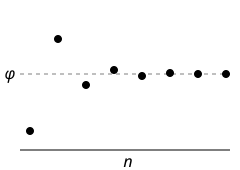

---
filters:
  - loimoi
title: Exercise sheet 1
subtitle: 'Convergence: Sequences'
---

## Part 1: On paper

::: {#exr-golden-ratio}
## The golden ratio

The Fibonacci numbers are $F_1 = F_2 = 1$ and $F_{n+2} = F_{n+1} + F_n$. Their ratios $q_n = F_{n+1} / F_n$ seem to converge:



1. Compute $q_1, \ldots, q_5$.

1. Show that $q_{n+1} = 1 + 1 / q_n$.

1. Assume that the sequence converges. Determine its limit.

::: {.lm-solution}
1. With $F_1, \ldots, F_6 = 1, 1, 2, 3, 5, 8$: $q_1 = 1$, $q_2 = 2$, $q_3 = 3/2$, $q_4 = 5/3$, $q_5 = 8/5$.

1. Dividing $F_{n+2} = F_{n+1} + F_n$ by $F_{n+1}$ gives $q_{n+1} = 1 + F_n / F_{n+1} = 1 + 1 / q_n$.

1. For the limit $q$, $q = 1 + 1/q$, so $q^2 - q - 1 = 0$. Since all $q_n \geq 1$, the limit is the positive root, the golden ratio
   $$
     \varphi = \frac{1 + \sqrt{5}}{2} \approx 1.618.
   $$
:::
:::

## Part 2: In Julia

Download the [work files](01-convergence-sequences-exercises.zip) and unzip them into your project folder. Develop your code in the notebook first. Once a function works, move it into the folder `src/` and include it from there.

```{julia}
#| label: setup
#| include: false
include("src/fibonacci.jl")
```

::: {#exr-fibonacci}
## How fast do the ratios converge?

### Implementation

Implement the function `fibonacci_ratios(n)`, which returns the vector of the ratios $q_1, \ldots, q_n$ from @exr-golden-ratio.

::: {.lm-scaffold}
```{julia}
# function fibonacci_ratios(n)
#     ...
# end
```
:::

::: {.lm-solution}
The function is in `src/fibonacci.jl` (see the appendix).
:::

### Errors

Compute the ratios for $n = 20$ together with their errors. By which factor does the error fall in each step?

::: {.lm-solution}
```{julia}
φ = (1 + sqrt(5)) / 2
ratios = fibonacci_ratios(20)
[ratios abs.(ratios .- φ)]
```

The error falls by the factor $\varphi^2 \approx 2.6$ in each step, and its sign alternates: the ratios lie alternately above and below $\varphi$.
:::
:::

## Appendix

### `src/fibonacci.jl`

```{.julia .number-lines}
# The ratios q_1, ..., q_n of consecutive Fibonacci numbers, q_k = F_{k+1} / F_k.
function fibonacci_ratios(n)
    a, b = 1, 1
    ratios = Float64[]
    for k in 1:n
        push!(ratios, b / a)
        a, b = b, a + b
    end
    return ratios
end
```
