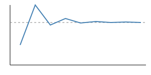

## Part 1: On paper

::: {#exr-golden-ratio}
## The golden ratio

The Fibonacci numbers are $F_1 = F_2 = 1$ and $F_{n+2} = F_{n+1} + F_n$. Their ratios $q_n = F_{n+1} / F_n$ seem to converge:



1. Compute $q_1, \ldots, q_5$.

1. Show that $q_{n+1} = 1 + 1 / q_n$.

1. Assume that the sequence converges. Determine its limit.
:::

## Part 2: In Python

Download the [work files](sheet-01.zip), unzip them into your project folder and open the notebook.

How to set up Python is explained on the [course page](https://matthiasbaitsch.github.io/quarto-loi-moi/index.html).

```{python}
#| label: setup
#| include: false
import csv
import math

# The Fibonacci numbers from the data file
F = [int(row["F"]) for row in csv.DictReader(open("daten/fibonacci.csv"))]
```

::: {#exr-fibonacci}
## How fast do the ratios converge?

The file `daten/fibonacci.csv` contains the first $30$ Fibonacci numbers $F_n$, the list `F` holds them.

### Implementation

Implement the function `fibonacci_ratios(F)`, which returns the list of the ratios $q_n = F_{n+1} / F_n$ from @exr-golden-ratio for a list `F` of Fibonacci numbers.

### Errors

Compute the ratios together with their errors. By which factor does the error fall in each step?
:::
