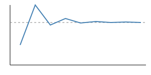

---
filters:
  - loimoi
title: Aufgabenblatt 1
subtitle: Sequences
---

## Part 1: On paper

::: {#exr-golden-ratio}
## The golden ratio

The Fibonacci numbers are $F_1 = F_2 = 1$ and $F_{n+2} = F_{n+1} + F_n$. Their ratios $q_n = F_{n+1} / F_n$ seem to converge:



1. Compute $q_1, \ldots, q_5$.

1. Show that $q_{n+1} = 1 + 1 / q_n$.

1. Assume that the sequence converges. Determine its limit.

::: {.lm-solution}
1. With $F_1, \ldots, F_6 = 1, 1, 2, 3, 5, 8$: $q_1 = 1$, $q_2 = 2$, $q_3 = 3/2$, $q_4 = 5/3$, $q_5 = 8/5$.

1. Dividing $F_{n+2} = F_{n+1} + F_n$ by $F_{n+1}$ gives $q_{n+1} = 1 + F_n / F_{n+1} = 1 + 1 / q_n$.

1. For the limit $q$, $q = 1 + 1/q$, so $q^2 - q - 1 = 0$. Since all $q_n \geq 1$, the limit is the positive root, the golden ratio
   $$
     \varphi = \frac{1 + \sqrt{5}}{2} \approx 1.618.
   $$
:::
:::

## Part 2: In Python

Download the [work files](sequences-aufgaben.zip), unzip them into your project folder and open the notebook.

How to set up Python is explained on the [course page](https://matthiasbaitsch.github.io/quarto-loi-moi/index.html).

```{python}
#| label: setup
#| include: false
import csv
import math

# The Fibonacci numbers from the data file
F = [int(row["F"]) for row in csv.DictReader(open("daten/fibonacci.csv"))]
```

::: {#exr-fibonacci}
## How fast do the ratios converge?

The file `daten/fibonacci.csv` contains the first $30$ Fibonacci numbers $F_n$, the list `F` holds them.

### Implementation

Implement the function `fibonacci_ratios(F)`, which returns the list of the ratios $q_n = F_{n+1} / F_n$ from @exr-golden-ratio for a list `F` of Fibonacci numbers.

::: {.lm-scaffold}
```{python}
def fibonacci_ratios(F):
    ...
```
:::

::: {.lm-solution}
The function is in `src/fibonacci.py` (see the appendix).

```{python}
from src.fibonacci import fibonacci_ratios
```
:::

### Errors

Compute the ratios together with their errors. By which factor does the error fall in each step?

::: {.lm-solution}
```{python}
phi = (1 + math.sqrt(5)) / 2
for q in fibonacci_ratios(F)[:20]:
    print(q, abs(q - phi))
```

The error falls by the factor $\varphi^2 \approx 2.6$ in each step, and its sign alternates: the ratios lie alternately above and below $\varphi$.
:::
:::

## Anhang

### `src/fibonacci.py`

```{.python .number-lines}
def fibonacci_ratios(F):
    """The ratios q_n = F[n+1] / F[n] of a list F of Fibonacci numbers."""
    return [b / a for a, b in zip(F, F[1:])]
```
